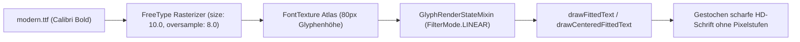
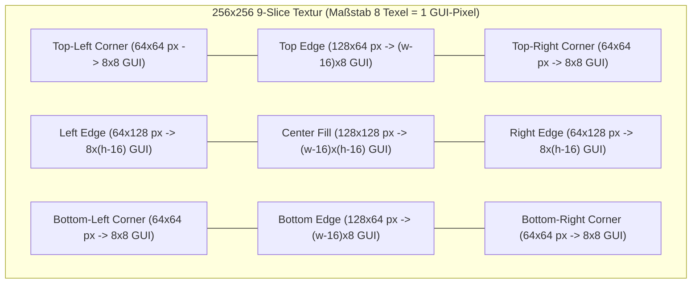

# enhancedGM — Modern Design System

Dieses Dokument beschreibt das **Modern Design-System** von **enhancedGM**, das durchgängig im Einstellungsmenü (`GMSettingsScreen`), im interaktiven HUD-Layout-Editor (`HudEditorScreen`) sowie in allen In-Game-HUD-Elementen (`HudOverlayRenderer` & `PlotModule`) zum Einsatz kommt.

---

## 1. Design-Philosophie & Leitprinzipien

1. **Zero Visible Pixels (Sub-Pixel Anti-Aliasing)**
   In Minecraft entspricht 1 logischer GUI-Pixel bei GUI-Skalierung 3 oder 4 einem Block aus **3×3 bzw. 4×4 physischen Bildschirm-Pixeln**. Klassische `graphics.fill(...)`-Aufrufe können nur ganzzahlige GUI-Koordinaten adressieren und erzeugen dadurch an abgerundeten Ecken, Schaltern und Diagonalen sichtbare Pixel-Treppen.
   **Lösung in enhancedGM:** Sämtliche abgerundeten Boxen, Karten, Buttons, Schalter, Regler und Icons werden als **8x- bis 32x-supersampled hochauflösende PNG-Texturen** mit aktivierter **Hardware-Bilinear-Filterung (`"blur": true, "clamp": true`)** gerendert.

2. **Hoher Kontrast & kontrollierte Opazität (90–94 % Dark Slate)**
   Zu starke Transparenz lässt helle Himmel- oder Baumtexturen der 3D-Welt durchscheinen und verschlechtert die Lesbarkeit.
   **Lösung in enhancedGM:** Alle Oberflächen nutzen ein tiefes, abgedunkeltes **Schiefer-Navy (`90 %` bis `97 %` Deckkraft)**. Die 3D-Welt bleibt am Fensterrand dezent wahrnehmbar, während weiße Schrift (`#FFFFFF`) auf den Karten jederzeit maximalen Kontrast besitzt.

3. **Adaptive Auto-Fit-Typografie (Kein Überlaufen aus Boxen)**
   Jedes Textfeld berechnet vor dem Zeichnen seine exakte Pixelbreite. Überschreitet eine Übersetzung oder ein dynamischer Wert die verfügbare Containerbreite (`maxWidth`), skaliert `drawFittedText` bzw. `drawCenteredFittedText` den Text über die GPU-Transformationsmatrix (`graphics.pose().scale(...)`) stufenlos und dank Bilinear-Filterung gestochen scharf passend in die Box.

---

## 2. Typografie-System (`gm-addon:modern`)

| Eigenschaft | Wert | Technische Begründung |
| :--- | :--- | :--- |
| **Schriftart** | **Calibri Bold** (`modern.ttf`) | Abgerundete, kräftige Strichstärke für optimale Lesbarkeit auf dunklen Hintergründen |
| **Logische Größe (`size`)** | `10.0` | Passt exakt in Minecrafts 8px-Zeilenhöhe und verhindert vertikales Abschneiden in Buttons & Eingabefeldern |
| **Supersampling (`oversample`)** | `8.0` | Rendert jede Glyphe intern mit ~80 px Höhe (256 Graustufen) im Texturatlas |
| **Baseline-Korrektur (`shift`)** | `[0.0, -0.5]` | Zentriert die Versalhöhe exakt mittig in Buttons, Badges und `EditBox`-Feldern |
| **GPU-Texturfilter** | `FilterMode.LINEAR` | Durch `GlyphRenderStateMixin` wird für `gm-addon:modern` bilineare Filterung statt `NEAREST` genutzt |

---

## 3. 8x-Supersampled 9-Slice-Oberflächen-Architektur

Damit Karten, Fenster und Buttons bei **jeder beliebigen Breite und Höhe** unverzerrte, glatte Rundungen und exakt `1 px` feine Anti-Aliasing-Rahmen behalten, nutzt `GMSettingsScreen.drawNineSlice(...)` **256×256 px 9-Slice-Texturen** (erzeugt auf einem `1024×1024`-Canvas mit Lanczos-Resampling):

- **Eck-Slices (`0.0..0.25` und `0.75..1.0`):** Werden immer im festen Verhältnis `64 Texel : 8 GUI-Einheiten` gezeichnet – der Kurvenradius wird niemals gestaucht oder gedehnt.
- **Kanten-Slices (`0.25..0.75`):** Werden nur entlang ihrer geraden Achse gestreckt; quer zur Rahmenlinie bleibt die 8-fache Auflösung vollständig erhalten.
- **Bilineares Sampling (`.png.mcmeta`):** Jede UI- und Icon-Textur besitzt eine `.png.mcmeta` mit `"blur": true` und `"clamp": true`.

---

## 4. Farbpalette & Oberflächen-Tokens

| Token / Textur | Farbwert (Top -> Bottom) | Rahmenfarbe | Deckkraft | Einsatzgebiet |
| :--- | :--- | :--- | :--- | :--- |
| `window_bg.png` | `#101622` -> `#0C111B` | `#38BDF8` (51 %) | **95 %** | Hauptfenster, Minimap-Rahmen, Tacho-Gehäuse, HUD-Editor-Leiste |
| `container_bg.png` | `#0A0E17` -> `#090D15` | `#334155` (63 %) | **90 %** | Sidebar, Haupt-Container, Minimap-Footer, Tempomat-Box, Icon-Badges |
| `card_normal.png` | `#212A3B` -> `#1A2231` | `#475569` (68 %) | **94 %** | Einstellungs-Karten (Standard), Detail-Leiste |
| `card_hover.png` | `#2A3852` -> `#222E44` | `#38BDF8` (92 %) | **97 %** | Einstellungs-Karten (Hover-Fokus) |
| `cat_active.png` | `#0373B2` -> `#025C91` | `#38BDF8` (100 %) | **97 %** | Aktive Sidebar-Kategorie (inkl. leuchtendem Cyan-Balken links) |
| `btn_accent.png` | `#0E91D7` -> `#0270AF` | `#38BDF8` (90 %) | **97 %** | Primäre Aktionen (`HUD-Editor`, `Speichern & Fertig`) |
| `btn_secondary.png` | `#263145` -> `#1E2738` | `#52627A` (75 %) | **95 %** | Sekundäre Aktionen (`Karte (M)`, `Zurücksetzen`, Cycle-Buttons) |
| `hud_alert_red.png` | `#2A1018` -> `#1C0C12` | `#EF4444` (96 %) | **96 %** | Blitzer-Warnung (Tempolimit überschritten), kritischer Grundstück-Ablauf |
| `hud_alert_amber.png` | `#261B0F` -> `#1A130B` | `#F59E0B` (94 %) | **95 %** | Blitzer-Vorwarnung, Spawnschutz (< 5 s), Grundstück-Vorwarnung |
| `hud_alert_green.png` | `#0E221C` -> `#0A1814` | `#10B981` (94 %) | **95 %** | Aktiver Spawnschutz, aktiver Tempomat |

---

## 5. Komponenten & HUD-Widgets im Überblick

### 5.1 Einstellungsmenü (`GMSettingsScreen`)
- **Animierte Pillenschalter (`AnimatedSwitchButton`):**
  - **ON:** Smaragdgrüne Kapsel (`switch_on.png`) mit weißem vertikalen Indikatorstrich `|` links.
  - **OFF:** Dunkle Schiefer-Kapsel (`switch_off.png`) mit korallenrotem Punkt `•` rechts.
  - **Knob:** Kreisförmiger weißer Regler (`switch_knob.png`) mit weichem Gauß-Schlagschatten und federnder Ease-Out-Animation (`~120 ms`).
- **2D Flat HD Icons (`128×128 px`):**
  - 17 dedizierte Vektor-Icons (`general`, `minimap`, `tacho`, `blitzer`, `protection`, `plot`, `debug`, `language`, `update`, `car`, `bell`, `marker`, `scale`, `hud`, `reset`, `search`, `close`) ersetzen Minecrafts 3D-ItemStacks vollständig.

### 5.2 In-Game HUD-Elemente (`HudOverlayRenderer` & `PlotModule`)
1. **BlueMap Minimap:**
   - Umschlossen vom abgerundeten `window_bg`-9-Slice-Rahmen mit eingelassenem `container_bg`-Footer.
   - Rotationsfähiger **128×128 HD Navigations-Pfeil (`hud_player_arrow.png`)** bzw. **GPS-Punkt (`hud_player_dot.png`)** ohne Pixel-Artefakte bei der Drehung.
   - Runde **128×128 HD Tempolimit-Schilder (`speed_sign.png`)** auf der Karte und abgerundetes Nord-Badge (`N`).
2. **Blitzer-Warnsystem (`renderBlitzerAlertWidget` & 3D-Marker):**
   - Dynamische 9-Slice-Warnkarte (`hud_alert_amber` bei Annäherung, `hud_alert_red` bei Geschwindigkeitsüberschreitung).
   - Echtes rundes europäisches Tempolimit-Verkehrsschild (`speed_sign.png`) mit zentrierter Calibri-Bold-Begrenzung und abgerundetem Annäherungs-Fortschrittsbalken.
   - Projizierte **3D-Welt-Marker** als schwebende abgerundete Kapseln mit Mini-Verkehrsschild und Distanzanzeige.
3. **Tacho & Tempomat (Analog & Digital):**
   - **Analog:** Abgerundetes Instrumentengehäuse mit **256×256 HD Ziffernblatt-Ring (`tacho_dial.png`)**, glatter Nadel, Schattennabe (`switch_knob.png`), digitaler km/h-Anzeige und abgerundeter Tempomat-/Tank-Kapsel.
   - **Digital:** Zweispaltiges Dashboard mit 128×128 Tacho-Icon im Header, groß skaliertem Calibri-Bold-Tacho links, abgerundeter Tempomat-Statuskarte rechts (`container_bg` / `hud_alert_green`) und rundem Fortschrittsbalken samt Tempomat-Zielmarker unten.
4. **Spawnschutz-Timer (`renderSpawnProtectionWidget`):**
   - Abgerundete Statuskarte (`hud_alert_green` -> wechselt ab 5,0 s Restzeit auf `hud_alert_amber`), links mit eingelassenem `128×128` Schild-Icon (`protection.png`), rechts mit Sekunden-Countdown und abgerundetem Fortschrittsbalken.
5. **Grundstück- & Wohnungs-Erinnerung (`PlotModule`):**
   - Abgerundete Erinnerungskarte (`hud_alert_amber` / `hud_alert_red`) mit `128×128` Haus-Icon (`plot.png`) im abgerundeten Badge und zweizeiliger Auto-Fit-Typografie für Objektname und Ablaufdatum.
