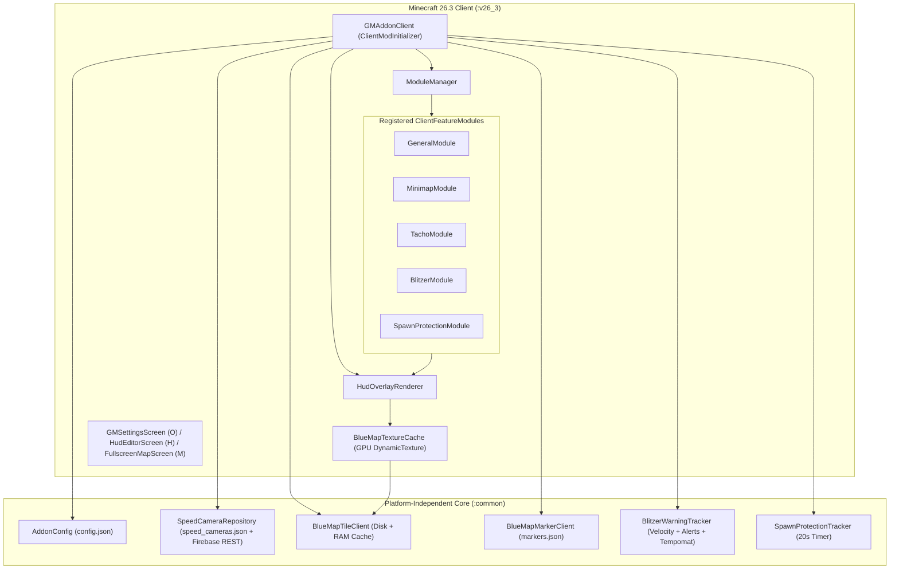

# GermanMiner Addon (`gm-addon`) — Complete System Architecture

This document explains how every part of the **GermanMiner Addon** works internally, from startup and server-detection to BlueMap tile streaming, Firebase Realtime Database synchronization, Speed Camera ("Blitzer") auto-detection, Speedometer ("Tacho") & Tempomat synchronization.

---

## 1. High-Level Architecture & Lifecycle

The addon is divided into two Gradle subprojects so all core algorithms can be unit-tested in pure Java (`:common`) while `:v26_3` handles Minecraft 26.3 rendering, keybindings, and Fabric events.



### Server Activation Check (`isActiveOnCurrentServer()`)
In [`GMAddonClient.isActiveOnCurrentServer()`](../v26_3/src/main/java/de/pflanzenkaktus/enhancedgm/client/GMAddonClient.java#L350-L364):
- By default, `config.forceEnableEverywhere = false` for release safety; it can be enabled in Settings for testing on other servers.
- When `forceEnableEverywhere = false`, the addon checks `Minecraft.getInstance().getCurrentServer().ip` against `config.serverDomainPattern` (`"germanminer.de"`).

---

## 2. Subsystem Deep Dives

### 2.1 BlueMap Tile Streaming & Dual-Layer PNG Cropping
- **Classes**: [`BlueMapTileClient`](../common/src/main/java/de/pflanzenkaktus/enhancedgm/map/BlueMapTileClient.java), [`BlueMapTextureCache`](../v26_3/src/main/java/de/pflanzenkaktus/enhancedgm/client/map/BlueMapTextureCache.java), [`BlueMapMarkerClient`](../common/src/main/java/de/pflanzenkaktus/enhancedgm/map/BlueMapMarkerClient.java)
- **How GermanMiner's BlueMap Works**:
  - GermanMiner hosts BlueMap at `http://map.germanminer.de:2086/` with map ID `world`.
  - Low-resolution tiles (`lod = 1`, `lod = 2`, `lod = 3`) are served at:
    ```text
    http://map.germanminer.de:2086/maps/world/tiles/{lod}/{xPath}/{zPath}.png
    ```
  - **Signed Digit-Split Coordinate Path (`formatSignedCoordPath`)**:
    - BlueMap splits multi-digit tile coordinates into nested folders: e.g., tile `x = -12` becomes `x-1/2`, tile `z = -4` becomes `z-4`, and tile `x = 35` becomes `x3/5`.
  - **Tile Math (`LOD 1`)**:
    - At `lod = 1`, each tile covers **`500 × 500` Minecraft blocks** (`500 × 2^(lod-1)`).
    - Block coordinate `b` maps to tile coordinate `Math.floorDiv((int) Math.floor(b), 500)`.
  - **Tile Caching Pipeline**:
    - Downloaded tiles are cached locally to disk (`config/gm-addon/tile_cache/`) with HTTP `If-None-Match` ETag caching and TTL management. Tiles are then uploaded to the GPU via an LRU-managed [`BlueMapTextureCache`](../v26_3/src/main/java/de/pflanzenkaktus/enhancedgm/client/map/BlueMapTextureCache.java).

---

### 2.2 Speed Camera ("Blitzer") Database, Auto-Detection & Firebase Sync
- **Classes**: [`SpeedCamera`](../common/src/main/java/de/pflanzenkaktus/enhancedgm/model/SpeedCamera.java), [`SpeedCameraRepository`](../common/src/main/java/de/pflanzenkaktus/enhancedgm/data/SpeedCameraRepository.java), [`BlitzerWarningTracker`](../common/src/main/java/de/pflanzenkaktus/enhancedgm/feature/BlitzerWarningTracker.java), [`BlitzerModule`](../v26_3/src/main/java/de/pflanzenkaktus/enhancedgm/client/module/BlitzerModule.java)
- **Data Model (`SpeedCamera`)**:
  ```json
  {
    "id": "auto_-2131_-1436",
    "name": "Blitzer 70er (-2131, -1436)",
    "x": -2131.3,
    "y": 65.0,
    "z": -1436.1,
    "speedLimitKmh": 70,
    "directionDegrees": 180.0,
    "triggerRadius": 0.0,
    "autoAdded": true,
    "addedBy": "GermanMinerPlayer",
    "createdAtEpochMs": 1792283552105
  }
  ```
- **Automatic Chat Flash Detection (`parseFlashedChatMessage`)**:
  - When a player gets flashed on GermanMiner, the server sends:
    `"Du wurdest mit 77 km/h in einer 70 km/h-Zone geblitzt. Du hast ein Bußgeld in Höhe von 10,00 Euro und 0 Punkte erhalten."`
  - [`BlitzerWarningTracker.parseFlashedChatMessage`](../common/src/main/java/de/pflanzenkaktus/enhancedgm/feature/BlitzerWarningTracker.java#L75-L124) strips formatting codes, ignores player chat (`Globalchat`, `[Zivilist]`, `Werbung`, `Megafon`), extracts the measured speed (`77`) and zone speed limit (`70`), and returns `FlashedEvent(77, 70)`.
- **Non-Stacking Spatial Deduplication (`blitzerDedupeRadiusBlocks = 28.0`)**:
  - Before adding any camera, [`SpeedCameraRepository.addOrMergeCamera`](../common/src/main/java/de/pflanzenkaktus/enhancedgm/data/SpeedCameraRepository.java) checks if any existing camera is within `28.0` blocks horizontally (and `25.0` blocks vertically).
  - If an existing camera is found within `28` blocks, **no second stacked camera is created**. Manually verified cameras (`autoAdded: false`) always take priority over auto-added entries.
- **Firebase Realtime Database Sync**:
  - Endpoint: `https://gm-addon-a5507-default-rtdb.europe-west1.firebasedatabase.app/speed_cameras.json`
  - Security Rules: Cloud database enforces append-only writes, URL blocking, and coordinate range limits.
  - On join and every 5 minutes, `syncWithFirebaseAsync()` performs an HTTP `GET`, merges remote and local cameras through the spatial deduplicator, and saves locally.
  - When a new Blitzer is auto-detected in chat, `uploadSingleCameraToFirebaseAsync()` immediately sends an HTTP `PATCH` to `/speed_cameras/{id}.json` so all other addon users receive the new camera.

---

### 2.3 Calibrated Speed (`km/h`), Analog/Digital Tacho & Tempomat Sync
- **Classes**: [`BlitzerWarningTracker`](../common/src/main/java/de/pflanzenkaktus/enhancedgm/feature/BlitzerWarningTracker.java), [`TachoModule`](../v26_3/src/main/java/de/pflanzenkaktus/enhancedgm/client/module/TachoModule.java), [`HudOverlayRenderer.renderTachoWidget`](../v26_3/src/main/java/de/pflanzenkaktus/enhancedgm/client/render/HudOverlayRenderer.java)
- **Why `speedCalibrationFactor = 2.70` is Used**:
  - In standard SI units, $1\text{ m/s} = 3.6\text{ km/h}$. However, GermanMiner's vehicle plugin scales movement speed so that a vehicle driving at **`50 km/h` server speed** moves at **$\approx 18.52\text{ blocks/s}$** ($18.52 \times 3.6 = 66.67$).
  - Multiplying `smoothedSpeedBlocksPerSec` by **`2.70`** ($18.52 \times 2.70 = 50.0\text{ km/h}$) produces the exact server `km/h`.
- **20 Hz Instant Speed Calculation**:
  - Every client tick (`50ms`), [`GMAddonClient.onClientTick`](../v26_3/src/main/java/de/pflanzenkaktus/enhancedgm/client/GMAddonClient.java) reads the root vehicle entity's position (`client.player.getRootVehicle()`) and updates `smoothedSpeedBlocksPerSec` using a fixed `0.05s` tick delta (eliminating frame-time jitter) and a fast `70%` new / `30%` previous filter (with immediate `0 km/h` snap when stopped).
- **Anti-Spam Tempomat Command Queue & 3-Layer Server Menu Sync**:
  - GermanMiner's Tempomat commands are `/vehicles tempomat`, `/vehicles tempomat-plus`, and `/vehicles tempomat-minus`.
  - Sending multiple slash commands in `< 500ms` triggers a server spam kick. Therefore, [`GMAddonClient`](../v26_3/src/main/java/de/pflanzenkaktus/enhancedgm/client/GMAddonClient.java) uses edge detection (ignoring OS key-repeat spam) and queues `+10` / `-10` steps in `pendingTempomatDeltaSteps`, dispatching at most **1 command per `500ms`** while updating the HUD immediately.
  - To prevent desync when changing Tempomat via the server's chest GUI (`/vehicles`), [`TachoModule`](../v26_3/src/main/java/de/pflanzenkaktus/enhancedgm/client/module/TachoModule.java) uses 3 layers:
    1. **Container Slot Click Hook (`onContainerScreenClick`)**: Uses `ScreenMouseEvents.beforeMouseClick` to detect clicks on Tempomat / `+10` / `-10` items inside `AbstractContainerScreen`.
    2. **Item Lore / BossBar / Chat Inspection**: Scans open container slots, hotbar items, BossBars, and chat messages for Tempomat status and `km/h`.
    3. **Steady-Cruise Self-Healing Auto-Sync (`checkSteadyCruiseAutoSync`)**: When holding `W` with Tempomat active at a steady `10 km/h` multiple for `24` ticks (`1.2s`), automatically self-corrects `tempomatSpeedKmh` to match the server's speed cap.

- **Automatic Engine Ignition (`autoMotorStart`)**:
  - When entering a motorized vehicle on GermanMiner, the server initially displays a BossBar with `Motor ausgeschaltet`.
  - When enabled (`config.autoMotorStart = true`), [`TachoModule`](../v26_3/src/main/java/de/pflanzenkaktus/enhancedgm/client/module/TachoModule.java) arms a 4-tick (~200ms) timer to allow vehicle session initialization, then automatically dispatches the `/vehicles motor` command.
  - State tracking (`hasAttemptedMotorStart`) ensures ignition is dispatched once upon entering and never re-ignites against the player's intent if stopped manually while parked. Dismounting resets the state for the next entry.

---
